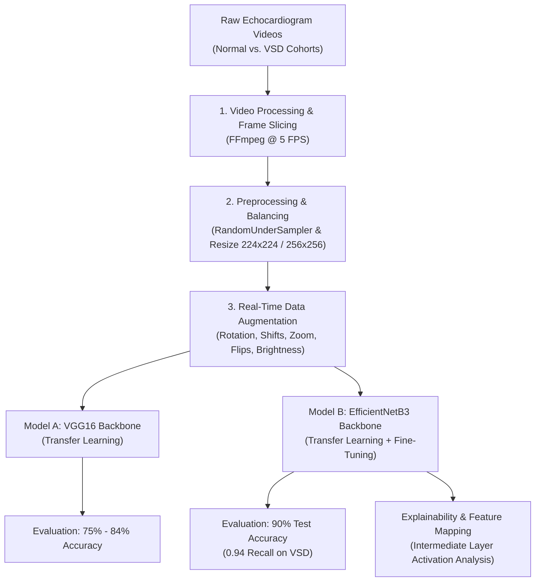

# 🫀 Heart Leaks Disease Classification (Ventricular Septal Defect)

[](https://www.python.org/)
[](https://www.tensorflow.org/)
[](https://scikit-learn.org/)
[](LICENSE)
[]()

An end-to-end Computer Vision deep learning pipeline designed to detect and classify **Congenital Heart Defects (CHD)**—specifically **Ventricular Septal Defect (VSD / Kebocoran Katup/Dinding Jantung)**—from clinical echocardiogram (ultrasound) video recordings.

This project implements a complete computer vision workflow: extracting frames from echocardiogram video clips, mitigating extreme class imbalance, applying domain-tailored data augmentation, fine-tuning deep convolutional backbones (**VGG16** and **EfficientNetB3**), and visualizing internal CNN feature activations for model interpretability.

---

## 📌 Table of Contents

- [Overview & Medical Background](#-overview--medical-background)
- [Key Features](#-key-features)
- [System Architecture](#-system-architecture)
- [Model Performance & Evaluation](#-model-performance--evaluation)
- [Model Explainability & Feature Maps](#-model-explainability--feature-maps)
- [Repository Structure](#-repository-structure)
- [Installation & Setup](#-installation--setup)
- [Pipeline Workflow & Usage](#-pipeline-workflow--usage)
- [Technologies & Libraries](#-technologies--libraries)
- [Authors & Acknowledgments](#-authors--acknowledgments)
- [License](#-license)

---

## 🩺 Overview & Medical Background

**Ventricular Septal Defect (VSD)** is one of the most prevalent congenital heart diseases, characterized by an abnormal opening in the wall separating the heart's lower ventricles. This defect permits oxygenated blood to leak from the left ventricle back into the right ventricle, potentially inducing pulmonary hypertension, irreversible vascular damage, and congestive heart failure if not diagnosed early.

Echocardiography (cardiac ultrasound) serves as the primary diagnostic imaging modality. However, manual interpretation is labour-intensive, subjective, and operator-dependent. 

This repository provides an automated, AI-assisted screening framework that:
1. Ingests raw echocardiography ultrasound footage.
2. Extracts and standardizes frame sequences across temporal cardiac cycles.
3. Automatically categorizes frames into **Normal** vs. **VSD** with high sensitivity and specificity.
4. Provides visual activation feedback to assist clinicians in inspecting learned cardiac anatomical features.

---

## 🚀 Key Features

- **Automated Video Ingestion & Frame Extraction**: Automated extraction from raw video data at fixed temporal sampling rates (5 FPS) utilizing FFmpeg bindings.
- **Robust Class Imbalance Handling**: Utilizes `RandomUnderSampler` from `imbalanced-learn` to establish balanced datasets across patient cohort distributions.
- **Dynamic Data Augmentation**: Real-time geometric transformations (affine rotations, shifts, shears, zooms, and horizontal/vertical reflections) and photometric adjustments (brightness shifts) to prevent overfitting on clinical imaging artifacts.
- **State-of-the-Art Deep Learning Models**:
  - **VGG16**: Deep CNN transfer learning benchmark.
  - **EfficientNetB3**: Compound-scaled neural network architecture yielding high accuracy and superior parameter efficiency.
- **High Sensitivity for Clinical Utility**: Achieved **94% Recall on VSD cases** with EfficientNetB3, minimizing false-negative diagnostic risks.
- **Feature Map Inspection**: Layer-by-layer activation map extraction (`block2a_activation`) offering explainability into intermediate representations.

---

## 🏗️ System Architecture



---

## 📊 Model Performance & Evaluation

Both architectures were benchmarked on stratified validation and test sets. **EfficientNetB3** demonstrated superior generalization, achieving an overall accuracy of **90%** and an F1-score of **0.90** on the critical VSD class.

### Comparative Summary

| Architecture | Input Resolution | Test Accuracy | VSD Precision | VSD Recall | VSD F1-Score | Best Val Loss |
| :--- | :---: | :---: | :---: | :---: | :---: | :---: |
| **VGG16 (Baseline)** | 224 × 224 | 75.0% | 0.81 | 0.66 | 0.73 | 0.4812 |
| **VGG16 (Tuned)** | 224 × 224 | 84.0% | 0.95 | 0.72 | 0.82 | 0.3685 |
| **EfficientNetB3 (Best)** | **256 × 256** | **90.0%** | **0.86** | **0.94** | **0.90** | **0.4032** |

### Detailed Classification Report (EfficientNetB3)

```text
              precision    recall  f1-score   support

      Normal       0.94      0.85      0.89        34
         VSD       0.86      0.94      0.90        34

    accuracy                           0.90        68
   macro avg       0.90      0.90      0.90        68
weighted avg       0.90      0.90      0.90        68
```

> **Clinical Implication**: In medical diagnostic systems, **Recall (Sensitivity)** on pathological cases (VSD) is paramount to avoid missing affected patients. EfficientNetB3 achieves **94% Recall on VSD**, ensuring minimal false-negative rate.

### Training Dynamics (EfficientNetB3)
- **Training Accuracy**: 92.76%
- **Validation Accuracy**: 89.55%
- **Early Stopping & Adaptive LR**: Monitored validation loss with `ReduceLROnPlateau` and model checkpointing to preserve optimal weights without overfitting.

---

## 🔍 Model Explainability & Feature Maps

In high-stakes medical AI applications, model interpretability is essential. The pipeline inspects intermediate convolutional representations (`scripts/6_imageSegmentation.ipynb`):
- Extracts activation matrices from early-to-mid convolution blocks (e.g., `block2a_activation` of EfficientNetB3).
- Visualizes 16 distinct feature maps revealing structural edges, cardiac chamber boundaries, and acoustic texture variations detected by the network.

---

## 📁 Repository Structure

```text
Heart-Leaks-Disease-Classification/
├── scripts/
│   ├── 1_videoProcessor.ipynb         # Frame extraction from raw ultrasound videos
│   ├── 2_preprocessData.ipynb         # Class undersampling, normalization, and resizing
│   ├── 3_trainingModel.ipynb          # VGG16 baseline construction & cross-validation
│   ├── 4_finalDestination.ipynb       # Detailed evaluation, confusion matrix, & thresholding
│   ├── 5_efficientnetModel.ipynb      # EfficientNetB3 training, fine-tuning, & benchmarks
│   ├── 6_imageSegmentation.ipynb      # Intermediate layer activation & feature map visualization
│   ├── best_efficientnetb3_model.h5  # Top-performing serialized model weights (90% Acc)
│   ├── best_vgg16_baru_model.h5       # Checkpointed VGG16 model weights
│   ├── best_vgg16_vsd_model.h5        # Trained baseline VGG16 model weights
│   ├── the-best_vgg16_vsd_model.h5    # Best iteration of VGG16 model weights
│   └── model_training_history.json    # Epoch-by-epoch loss & accuracy log
├── .gitignore                         # Git exclusion rules
├── LICENSE                            # Apache 2.0 open-source license
├── README.md                          # Comprehensive project documentation
└── requirements.txt                   # Structured Python dependency specifications
```

---

## ⚙️ Installation & Setup

### 1. Prerequisites
- **Python**: Version `3.10`, `3.11`, or `3.12` recommended.
- **FFmpeg**: System binary required for frame extraction from video files.
  - **Ubuntu / Debian**: `sudo apt update && sudo apt install -y ffmpeg`
  - **macOS** (Homebrew): `brew install ffmpeg`
  - **Windows** (Chocolatey / Scoop): `choco install ffmpeg` or `scoop install ffmpeg`

### 2. Clone the Repository
```bash
git clone https://github.com/Daffin-TW/Heart-Leaks-Disease-Classification.git
cd Heart-Leaks-Disease-Classification
```

### 3. Set Up Virtual Environment
```bash
# Create virtual environment
python3 -m venv venv

# Activate environment
# On Linux / macOS:
source venv/bin/activate
# On Windows (cmd/PowerShell):
.\venv\Scripts\activate
```

### 4. Install Dependencies
```bash
pip install --upgrade pip
pip install -r requirements.txt
```

---

## 🔄 Pipeline Workflow & Usage

Execute the Jupyter notebooks in chronological order:

1. **Video Ingestion & Frame Extraction** (`scripts/1_videoProcessor.ipynb`):
   - Place raw videos inside `rawDataset/Normal/` and `rawDataset/VSD/`.
   - Runs FFmpeg extraction to decompose continuous clips into discrete PNG frames at 5 FPS into `rawFrame/`.

2. **Dataset Preprocessing & Balancing** (`scripts/2_preprocessData.ipynb`):
   - Addresses cohort class imbalance using `RandomUnderSampler`.
   - Normalizes pixel channels and exports uniform image dimensions into `preproDataset/`.

3. **VGG16 Model Development** (`scripts/3_trainingModel.ipynb`):
   - Establishes transfer learning pipeline using pre-trained ImageNet weights on VGG16.
   - Applies early stopping, learning rate schedules, and cross-validation.

4. **In-depth Evaluation & Error Analysis** (`scripts/4_finalDestination.ipynb`):
   - Generates confusion matrices, classification reports, and conditional probability metrics for diagnostic thresholding.

5. **EfficientNetB3 Pipeline (Champion Model)** (`scripts/5_efficientnetModel.ipynb`):
   - Trains and evaluates EfficientNetB3 with data augmentation.
   - Achieves the benchmark **90% accuracy** and exports `best_efficientnetb3_model.h5`.

6. **Explainability & Feature Mapping** (`scripts/6_imageSegmentation.ipynb`):
   - Inspects intermediate feature representations across early and deep convolutional filters.

---

## 🛠️ Technologies & Libraries

- **Deep Learning**: [TensorFlow](https://www.tensorflow.org/) & Keras (VGG16, EfficientNetB3)
- **Computer Vision & Video**: [python-ffmpeg](https://github.com/jonghwanhyeon/python-ffmpeg), [Pillow](https://python-pillow.org/)
- **Data Engineering**: [Pandas](https://pandas.pydata.org/), [NumPy](https://numpy.org/)
- **Imbalance Handling & Metrics**: [imbalanced-learn](https://imbalanced-learn.org/), [Scikit-Learn](https://scikit-learn.org/)
- **Visualization**: [Matplotlib](https://matplotlib.org/), [Seaborn](https://seaborn.pydata.org/)
- **Interactive Development**: JupyterLab, IPyKernel

---

## 👥 Authors & Acknowledgments

- **Daffin Tanjiro Widison** ([@Daffin-TW](https://github.com/Daffin-TW))
- **Ikmal Thariq Kadafi**

Developed as part of the **MBKM Advanced With Unity** initiative. Special thanks to clinical datasets and academic mentors supporting computer vision applications in medical healthcare diagnostics.

---

## 📄 License

This project is licensed under the **Apache License 2.0** - see the [LICENSE](LICENSE) file for full legal terms and conditions.
